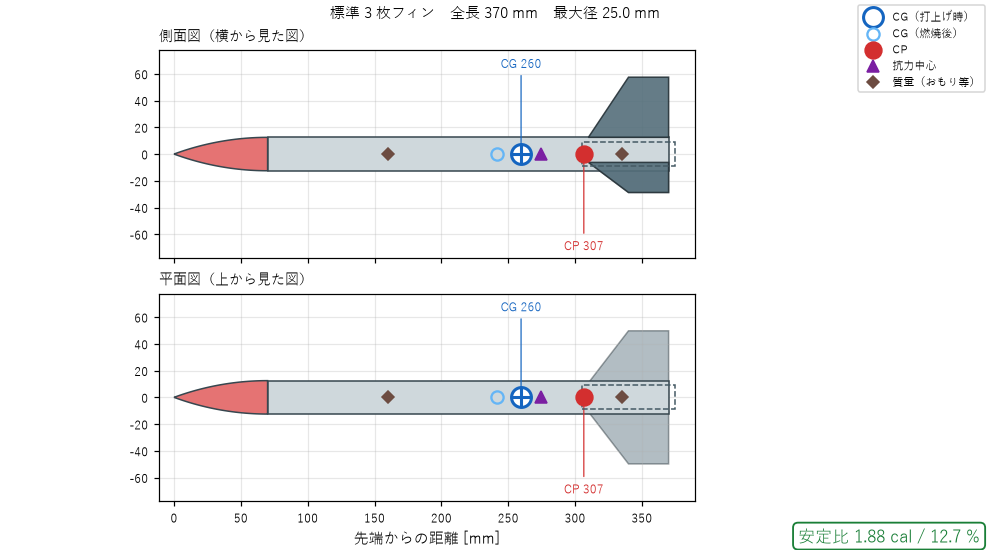
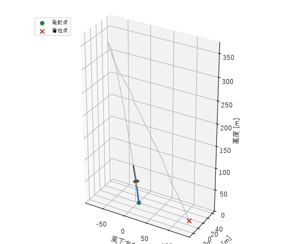
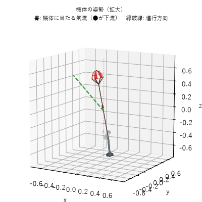
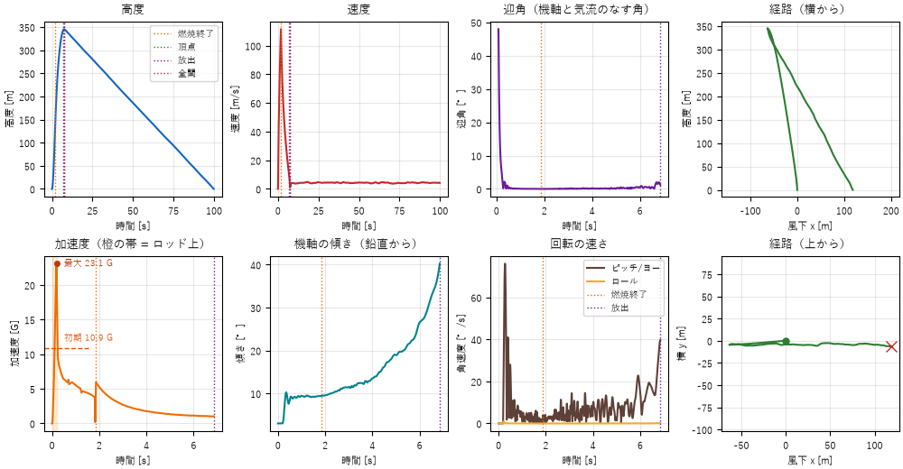

# モデルロケット設計ツール

[](https://github.com/tumiki0312/model-rocket-designer/actions/workflows/test.yml)
[](https://github.com/tumiki0312/model-rocket-designer/releases/latest)

モデルロケットの形を部品から組み立てて、**安定性（安定比 cal / %）・空気抵抗・6 自由度の飛行（軌道と姿勢の 3D 表示）・パラシュートでの回収**までを計算する Windows アプリです。
球体型・飛行機型などの変わった形や、モーターを複数本使うクラスターにも対応しています。

| 機体図と安定性 | 3D で飛行を再生 | パラシュートの展開 |
|---|---|---|
|  |  |  |



## ダウンロードと起動（Windows 10 / 11）

1. [**最新リリース**](https://github.com/tumiki0312/model-rocket-designer/releases/latest) のページで `RocketDesign-<版>-windows.zip` をダウンロードします。
2. zip を右クリック →「すべて展開」で解凍します。
3. `RocketDesign` フォルダの中の `RocketDesign.exe` をダブルクリックします。Python などのインストールは不要です。

- 「Windows によって PC が保護されました」と表示されたら、「詳細情報」→「実行」を押してください（電子署名をしていないため表示されます）。
- `RocketDesign.exe` は同じフォルダの `_internal` を使うので、移動するときは**フォルダごと**移動してください。
- 削除はフォルダを消すだけです。

使い方は、アプリの「ヘルプ → マニュアル」（**F1** キー）で見られます。目次と検索があります。

> 計算結果はあくまで目安です。実際に打ち上げるときは、所属する団体や法令の安全規則に必ず従ってください。

## 開発する人へ

### Python から起動する
```
pip install -r requirements.txt
python main.py
```

### アプリ（.exe）を作る
`build.bat` をダブルクリックします。ビルド用の環境 `.venv-build` を作り（初回のみ）、`.exe` の作成 → 動作確認 → 配布用 zip（`dist/`）の作成まで行います。

### 新しいバージョンを公開する
1. `rocketcalc/__init__.py` の `__version__` を上げてコミットし、push します（例: `1.1.0`）。
2. GitHub でリリースを作ります（タグは `v` ＋ バージョン、例: `v1.1.0`）。
   ```
   gh release create v1.1.0 --title "v1.1.0" --generate-notes
   ```
3. GitHub Actions が Windows 用の `.exe` を作り、動作確認したうえで zip をリリースに自動で添付します（数分かかります）。

## 機体の組み立て（左の「機体構成」タブ）

機体は、先端から順に積み重ねた部品でできています。順番は ▲▼ で入れ替えられます。

| 部品 | 内容 |
|---|---|
| ノーズコーン | オジャイブ／コーン／放物線／楕円／ハーク（フォン・カルマン、LV-Haack）／べき乗 |
| ボディチューブ | 太さの違うチューブを重ねれば、段付きの機体になります |
| トランジション | 円錐台。太くする・細くする（ボートテール）のどちらにも使えます |
| 球・楕円体 | 球体型ロケット用。鈍頭物体として計算します（揚力なし・大きな形状抗力） |
| 自由形状ボディ | 「x, 直径」の点列で好きな外形を描けます。直径 0 から始めるとノーズになります |
| フィン | 台形／楕円／自由形状（点列）。枚数は 1〜8 枚。複数のセットを付けられます（カナードなど）。取付角（キャント）、取付迎角（主翼の揚力）、取付方向、断面形状、位置も指定できます。飛行機型なら「主翼 2 枚・90°」「水平尾翼 2 枚・90°」「垂直尾翼 1 枚・0°」 |
| 質量 | おもり・パラシュート・搭載物などの点質量 |

- 各部品の質量は、材質と肉厚から推定します。実測値を入力するとそちらを優先します
- 「機体全体」を選ぶと、実測した質量・重心や、Cd の手動指定などを設定できます
- メニューの「テンプレート」に、いろいろな形状の例があります（カナード付き、段付き、スピン、自由形状、球体型、飛行機型、不安定な例など）

## 計算結果（右のタブ）

| タブ | 内容 |
|---|---|
| 機体図・安定性 | 側面図と平面図、CP・CG・抗力中心、安定マージン（非対称な機体はピッチとヨーを別々に）、部品ごとの CNα |
| 空力・質量 | 抗力係数の内訳と速度による変化、迎角による CP の移動、部品ごとの質量 |
| 飛行解析（6自由度） | 高度・速度・迎角・加速度・機軸の傾き・回転の速さ・経路（横から／上から） |
| 3D 姿勢ビュー | 飛行を 3D で再生します。左は軌道全体、右は機体の拡大（姿勢と、機体に当たる気流）。回収時は「放出の煙 → ノーズ分離（ショックコードが伸びる）→ パラシュートが開く → 機体が吊り下がる」まで表示します。再生速度の変更、イベント（燃焼終了・頂点・放出・ノーズ分離・全開など）へのジャンプ、カメラ追従ができます |
| 回収 | パラシュートの降下速度、必要な直径の逆算（分離・開傘にかかる時間と開傘衝撃は「飛行解析」の表に出ます） |
| モーター | 推力曲線、`.eng` ファイルの読み込み、全モーターでの比較 |

「モーター・飛行条件」タブでは、モーターの本数（クラスター: 1〜9 本、円周配置／中心＋周り、周りを別の種類に、点火不良の想定）、突風の強さ、推力のずれ角などを設定できます。風や取付誤差で姿勢がどう乱れるかを確認できます。

## 計算モデル

- **CP**: 胴体は細長物体理論（任意の外形を数値積分。Barrowman 法の一般化）、フィンは Diederich の式（任意の平面形を短冊に分割）＋胴体との干渉。大迎角では胴体揚力も考慮します。フィンは 1 枚ずつ取付方向を考え、ピッチ面とヨー面で別々に CP を求めます
- **安定性の判定**: 通常は口径で判定します。全長が直径の 5 倍未満のずんぐりした機体（球体型など）は全長比（10 % 以上が目安）で判定します
- **抗力**: 表面摩擦（レイノルズ数・粗さ）、底面、フィンの前縁と後縁、段差・傾斜面、球・楕円体の形状抗力を積み上げます。各抗力の作用位置から「抗力中心」を求め、飛行計算ではそこに抗力を働かせます
- **飛行**: 6 自由度の剛体モデル（RK4 で積分）。迎角に応じた法線力による復元モーメント、空力とジェットによる減衰、突風、推力のずれを扱います。フィンは 1 枚ずつ局所の気流（機体の回転分を含む）から力を求めるため、ロール・取付迎角・飛行機のような非対称配置も扱えます。ランチロッド上ではロッド方向に拘束します
- **回収**: 放出 → ノーズ分離（ショックコード長 ÷ 放出速度）→ 開傘（抗力面積が時間の 2 乗で増加。開傘時間は指定しなければ 8×直径÷速度 で推定）→ 降下。開傘衝撃（最大の加速度）も求めます
- 亜音速が前提です（マッハ 0.6 を超えると警告します）。結果はあくまで目安です。実際に打ち上げるときは、各団体の安全規則に従ってください

## 構成

```
main.py                   起動（--selftest で動作確認）
.github/workflows/        自動テストと、リリース時の .exe 作成
build.py / build.bat      アプリ（.exe）を作る
RocketDesign.spec         PyInstaller の設定
assets/                   アイコン
tools/make_icon.py        アイコンを作る
tools/make_screenshots.py README の画像（docs/images）を作る
rocketcalc/components.py  部品・形状・質量
rocketcalc/aero.py        CP・法線力・抗力
rocketcalc/design.py      設計のまとめ・安定性・大気・回収
rocketcalc/flight.py      6 自由度飛行シミュレーション
rocketcalc/motors.py      推力データ（.eng）
rocketcalc/templates.py   機体テンプレート
rocketcalc/gui/           画面（エディタ・3D ビュー・マニュアル manual.py など）
tests/                    テスト
```

## テスト

```
python -m unittest discover tests
```
